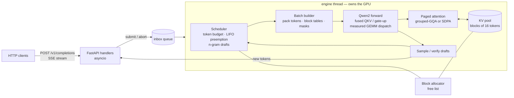

# nanoserve

**An LLM inference engine written from scratch: paged KV cache, continuous batching with
chunked prefill, preemption, speculative decoding, and an OpenAI-compatible streaming
server, running Qwen2.5-0.5B on a 4 GB laptop GPU.**

No `transformers` modelling code and no vLLM at runtime (vLLM appears only as a benchmark
baseline). The model forward pass is hand-written in PyTorch against the raw safetensors
weights. Hugging Face is used only as the reference the tests compare against.

**In short**, on a GTX 1650 (4 GB, no tensor cores):
- **231.7 output tok/s** on a ragged 64-request workload: **9.5x** Hugging Face `generate`,
  and **2.6x vLLM 0.34** on this card (why, and why that would reverse on a tensor-core GPU:
  [below](#offline-throughput-64-ragged-requests-all-submitted-at-once)).
- **3.2x** more from speculative decoding on copy-heavy prompts, with output identical to
  plain greedy; close to nothing on open-ended text, measured rather than hidden.
- **62 tests**, run in fp32, require every batching feature (continuous batching, chunked
  prefill, preemption, speculation) to reproduce Hugging Face's greedy output token for
  token. The tests were mutation-checked.

## Results

GTX 1650 Mobile (4 GB, Turing TU117, **no tensor cores**), Qwen2.5-0.5B-Instruct in fp16,
greedy decoding. Every number below is generated from `results/` by `scripts/make_tables.py`.

### Offline throughput: 64 ragged requests, all submitted at once

Prompts 32-512 tokens, outputs 32-256 tokens (fixed per request with `ignore_eos`), seeded,
the same list for every engine. This is vLLM's `--dataset random` construction: token
content does not change compute, but the length *spread* is exactly what static batching
wastes.

<!-- table:offline -->
| engine | output tok/s | vs HF sequential | wall time | memory for KV / activations |
|---|---:|---:|---:|---|
| HF `generate`, one request at a time | 24.5 | 1.0x | 357 s | 32 MiB peak above weights |
| HF `generate`, static batches of 16 (left-padded) | 28.9 | 1.2x | 303 s | 394 MiB peak above weights; 42% of generated tokens discarded |
| vLLM 0.34 (CUDA graphs + torch.compile, Triton attention) | 90.4 | 3.7x | 97 s | paged KV pool (its own allocator) |
| nanoserve, stock cuBLAS for every matmul | 90.2 | 3.7x | 97 s | 148 MiB of KV at peak, 98% slot utilisation |
| **nanoserve** (measured GEMM dispatch) | **231.7** | **9.5x** | 38 s | 148 MiB of KV at peak, 98% slot utilisation |
<!-- /table:offline -->

- **9.5x HF sequential, 8.0x HF static batching.** Static batching barely beats sequential
  here: each batch runs until its longest request finishes, 42% of the tokens it generates
  are thrown away, and the larger batch drops straight onto this GPU's slow cuBLAS path.
- **The scheduler alone is worth 3.7x** (stock cuBLAS, same engine). **The measured GEMM
  dispatch is worth another 2.6x** on top.
- **vLLM vs nanoserve, read carefully.** vLLM runs here (`bench/vllm_offline.py`, own
  venv, same requests, `max_num_seqs=32`) and gets 90.4 tok/s, *the same as nanoserve on
  stock cuBLAS (90.2)*. That is expected: vLLM's linear layers also call fp16 cuBLAS, so
  it hits the same tensor-core cliff on this card. CUDA graphs and torch.compile can't
  recover matmuls that run 2.5-16x slower than they should. nanoserve's 2.6x over vLLM is the GPU-specific GEMM
  dispatch, not a better general-purpose engine; on any GPU with tensor cores vLLM would
  be far ahead. FlashAttention-2 is unavailable on sm_75, so vLLM used its Triton
  attention backend.
- Where the 38 s goes (`results/step_breakdown.json`): 325 pure-decode steps averaging
  67 ms at a mean batch of 24, and 36 steps carrying all 16,276 prompt tokens at about
  1,000 prefill tok/s.

### Step-level: prefill and decode

<!-- table:steps -->
| | stock cuBLAS | measured dispatch |
|---|---:|---:|
| prefill 1 x 1024 tokens | 497 tok/s | **1252 tok/s** (0.95 TFLOP/s, 25% of fp32 peak) |
| prefill 4 x 256 tokens | 511 tok/s | **1435 tok/s** (1.04 TFLOP/s, 28% of fp32 peak) |
| decode step, batch 1 | 34.5 ms (29 tok/s) | **33.4 ms (30 tok/s)** |
| decode step, batch 2 | 166.2 ms (12 tok/s) | **46.3 ms (43 tok/s)** |
| decode step, batch 8 | 168.2 ms (48 tok/s) | **46.9 ms (171 tok/s)** |
| decode step, batch 16 | 171.1 ms (94 tok/s) | **46.5 ms (344 tok/s)** |
| decode step, batch 32 | 176.2 ms (182 tok/s) | **62.2 ms (514 tok/s)** |
<!-- /table:steps -->

Prefill is compute-bound and runs as fp32 SGEMM. FLOPs are 2 x the 358M non-embedding
parameters per token plus attention; the peak is 1,024 FP32 cores x 2 x the SM clock that
`nvidia-smi` reported during the run.

Decode from batch 2 to 16 costs the same ~46 ms per step: at these sizes a step is bound by
latency and kernel launches (hundreds of small kernels across 24 layers, each dispatched
from Python), not by bandwidth or FLOPs. So batch 16 is nearly free relative to batch 2,
and batch 1 (33 ms) is the regime CUDA graphs exist for; see "What I'd do next".

### Online serving: Poisson arrivals, streaming over HTTP

40 requests from the same random workload, arriving as a Poisson process at the offered
rate, each streamed over SSE. TTFT = time to first token; TPOT = mean time per output
token after the first.

<!-- table:online -->
| server | req/s offered | output tok/s | TTFT p50 | TTFT p99 | TPOT p50 | TPOT p99 | end-to-end p50 |
|---|---:|---:|---:|---:|---:|---:|---:|
| nanoserve | 1 | 90.6 | 213 ms | 612 ms | 64 ms | 76 ms | 7.7 s |
| nanoserve | 2 | 148.9 | 235 ms | 621 ms | 74 ms | 106 ms | 9.1 s |
| nanoserve | 4 | 189.6 | 402 ms | 3.0 s | 98 ms | 139 ms | 13.0 s |
| nanoserve, max 1 sequence | 1 | 26.7 | 72.9 s | 144.3 s | 36 ms | 38 ms | 79.5 s |
| nanoserve, max 1 sequence | 2 | 26.5 | 85.6 s | 169.4 s | 36 ms | 39 ms | 93.0 s |
| nanoserve, max 1 sequence | 4 | 26.8 | 88.5 s | 179.3 s | 36 ms | 41 ms | 95.6 s |
| FastAPI + HF `generate` | 1 | 27.4 | 71.4 s | 139.6 s | 32 ms | 37 ms | 77.6 s |
| FastAPI + HF `generate` | 2 | 27.9 | 80.2 s | 159.9 s | 31 ms | 34 ms | 86.7 s |
| FastAPI + HF `generate` | 4 | 28.1 | 86.1 s | 171.2 s | 31 ms | 35 ms | 92.7 s |
<!-- /table:online -->

Both sequential servers saturate below 1 req/s (about 27 tok/s), so their latency is almost
all **queueing**: a request at 1 req/s waits over a minute before its first token.
nanoserve keeps TTFT p50 at 0.2-0.4 s up to 4 req/s. The price of batching shows up as
TPOT, 64 ms rising to 98 ms per token, because every step carries more sequences. That is
the continuous-batching trade-off made visible.

### Speculative decoding (n-gram drafts)

Real chat prompts, greedy, up to 384 tokens. *Copy-heavy* = rename variables, add
docstrings, rewrite a paragraph with small edits (most of the answer is in the prompt).
*Open-ended* = stories and explanations: the control.

<!-- table:spec -->
| workload | concurrent | k | tok/s | speed-up | draft acceptance | tokens per forward (batch 1) | output == batch-1 plain greedy |
|---|---:|---:|---:|---:|---:|---:|---:|
| copy-heavy | 1 | 0 | 27.8 | 1.00x | – | 1.00 | 6/6 |
| copy-heavy | 1 | 2 | 47.1 | 1.69x | 79% | 2.44 | 6/6 |
| copy-heavy | 1 | 4 | 64.0 | 2.30x | 67% | 3.34 | 6/6 |
| copy-heavy | 1 | 8 | 89.6 | 3.22x | 59% | 4.82 | 6/6 |
| copy-heavy | 6 | 0 | 85.8 | 1.00x | – | – | 6/6 |
| copy-heavy | 6 | 2 | 146.3 | 1.71x | 79% | – | 6/6 |
| copy-heavy | 6 | 4 | 168.0 | 1.96x | 67% | – | 6/6 |
| copy-heavy | 6 | 8 | 187.9 | 2.19x | 59% | – | 6/6 |
| open-ended | 1 | 0 | 28.1 | 1.00x | – | 1.00 | 6/6 |
| open-ended | 1 | 2 | 30.6 | 1.09x | 30% | 1.38 | 5/6 |
| open-ended | 1 | 4 | 34.1 | 1.21x | 22% | 1.51 | 5/6 |
| open-ended | 1 | 8 | 33.9 | 1.21x | 12% | 1.52 | 4/6 |
| open-ended | 6 | 0 | 100.4 | 1.00x | – | – | 5/6 |
| open-ended | 6 | 2 | 112.3 | 1.12x | 33% | – | 4/6 |
| open-ended | 6 | 4 | 104.2 | 1.04x | 21% | – | 4/6 |
| open-ended | 6 | 8 | 93.9 | 0.94x | 13% | – | 4/6 |
<!-- /table:spec -->

- **3.2x at batch 1 on copy-heavy work** (k=8, 59% acceptance, 4.8 tokens per forward),
  with every output identical to plain greedy.
- **On open-ended text it is close to useless**, and at concurrency 6 with k=8 it is a net
  loss (0.94x). The GPU is already busier there, so verifying rejected drafts costs real
  time. A production server should adapt k to the measured acceptance per request. That
  is listed under "next".
- The "identical" column is fp16 reality. Speculation is lossless by construction, and the
  fp32 tests assert identity. In fp16, a verify pass runs matmuls with k+1 rows and
  different batch compositions route to different GEMM implementations, so ULP-level
  differences can flip a near-tied argmax late in a long open-ended answer. Batching
  without speculation shows the same effect (5/6 at concurrency 6, k=0).

---

## Architecture



One step of the engine loop:

1. **Schedule.** Every sequence has `num_tokens - num_computed` tokens that are known but
   not yet in the KV cache. That is the whole prompt for a new request, exactly 1 for a
   decoding one, and prompt + output for one resumed after preemption. Running sequences
   claim the step's token budget first. Waiting ones are admitted with whatever is left,
   while blocks are free. A long prompt is cut into chunks across steps, so it never stalls
   in-flight decodes.
2. **Pack.** All scheduled tokens from all sequences become one flat batch of T tokens.
   For attention, each sequence gets its block table, its context length and its query
   length.
3. **Forward.** Linear layers see a single (T, 896) matrix. Attention scatters the new K/V
   into their slots, gathers each sequence's blocks, and applies a causal mask written in
   absolute positions. The same code path serves prefill, decode, chunked prefill and
   speculative verification.
4. **Sample or verify.** Logits are computed only for rows that will be sampled (1 row for
   a 500-token prefill, not 500). Speculative rows are verified against their drafts.

## Design decisions (and the measurement behind each)

### Paged KV cache
The pool is preallocated once from free GPU memory and split into 16-token blocks. Each
sequence holds a block table, so logical position `p` lives at slot
`table[p // 16] * 16 + p % 16`. A sequence grows one block at a time. Waste is bounded by
the unfilled tail of each sequence's last block, never by reserving a max-length buffer up
front. The allocator is an all-or-nothing free list, and it is property-tested with
Hypothesis (no double allocation, no leaks, failed allocations leave no partial state).

### One scheduler for prefill, decode and speculation
There is no separate prefill phase. Each sequence asks for its uncached tokens, the step
has a token budget (`max_num_batched_tokens`), and a prompt larger than the budget is
**chunked**. That decouples prompt length from decode latency: a 4,000-token prompt
arriving does not freeze 31 other streams for the length of its prefill.

### Preemption by recompute, LIFO
When a running sequence needs a block and none is free, the **newest** running sequence is
evicted. It has the least work to throw away, and evicting the oldest could starve it
forever. Its blocks are freed and it re-enters the queue *first*; on resumption its prompt
and its already-generated tokens are prefilled again. Swapping to CPU would move 12 KB per
token over PCIe. Re-running prefill on a 0.5B model is cheaper. Speculative drafts are
shed before anyone is evicted.

### Speculative decoding without a draft model
There is no Qwen2.5 smaller than 0.5B to act as a draft model, and 1.5B target + 0.5B draft
does not fit in 4 GB. So drafts come from **prompt lookup**: find the most recent earlier
occurrence of the last n tokens (n = 3, 2, 1) and propose what followed. The target model
scores [last token, d1..dk] in one forward pass.
- **Greedy**: accept while the draft equals the argmax, then emit the target's own token.
  The output is token-for-token plain greedy (asserted in the fp32 tests).
- **Sampling**: with a deterministic drafter, speculative rejection sampling reduces to
  "accept d with probability p(d); otherwise sample from p with d removed". A chi-square
  test over 40,000 trials checks the emitted distribution equals p, including for drafts
  the target thinks are unlikely.

### Attention: two kernels, chosen per step
Measured on the GTX 1650 (`scripts/bench_attention.py`, including the block gather), the right attention kernel depends on
how many query tokens a sequence brings to the step:

<!-- table:attention -->
| shape | SDPA (mem-efficient) | grouped-GQA matmul |
|---|---:|---:|
| 8 seqs x 1 query x 512 context | 1.93 ms | **0.50 ms** |
| 32 seqs x 1 query x 512 context | 5.56 ms | **0.74 ms** |
| 16 seqs x 1 query x 1024 context | 5.62 ms | **0.78 ms** |
| 8 seqs x 5 query x 512 context | 1.45 ms | **0.52 ms** |
| 1 seqs x 256 query x 256 context | **0.47 ms** | 1.09 ms |
| 4 seqs x 512 query x 512 context | **5.76 ms** | 15.36 ms |
<!-- /table:attention -->

*Grouped-GQA*: Qwen2.5-0.5B has 14 query heads sharing 2 KV heads, so the 7 query heads of a
group become 7 extra rows of one matmul against their shared K. That gives 2 (7 x L)
products instead of 14 (1 x L) ones, and K/V are never expanded. Each step is split into a
short-query group (decode, verify) and a long-query group (prefill chunks), and each is
attended with its own kernel.

Two measured fixes inside the grouped path:
- **`P @ V` is computed as `(Vᵀ Pᵀ)ᵀ`.** With 7 rows, the direct form gets cuBLAS's slow
  kernel on this GPU. Swapping the operands makes the row count 64 and selects a fast one:
  2.5-7x faster, identical maths.
- **No padding across groups.** The first version padded every sequence in a step to the
  step's longest query. In a mixed step (24 decodes + one 450-token prefill chunk) that
  attended about 28x more query rows than were real, and prefill throughput in the offline
  benchmark collapsed to 393 tok/s. Splitting the groups brought it to 1,030 tok/s.

### GEMM dispatch measured per shape, not hard-coded
My earlier project [inferbench](https://github.com/9shrey/inferbench) found that on this GPU
(TU117, no tensor cores) cuBLAS sends fp16 matmuls with 2+ rows to a kernel built for tensor
cores, and wrote a split-K Triton kernel for 2-16 rows. A server needs more than that rule,
and measuring each projection separately showed why:

| projection (N x K) | M | cuBLAS fp16 | Triton kernel | fp32 upcast | chosen |
|---|---:|---:|---:|---:|---|
| qkv (1152 x 896) | 2 | 0.38 | **0.15** | – | kernel |
| qkv (1152 x 896) | 16 | 0.38 | **0.15** | – | kernel |
| qkv (1152 x 896) | 32 | 0.39 | 0.38 | **0.20** | fp32 |
| qkv (1152 x 896) | 256 | 1.69 | 2.90 | **0.48** | fp32 |
| qkv (1152 x 896) | 1024 | 6.79 | – | **1.59** | fp32 |
| o (896 x 896) | 2 | 0.29 | **0.15** | – | kernel |
| o (896 x 896) | 16 | 0.29 | **0.15** | – | kernel |
| o (896 x 896) | 32 | 0.29 | 0.38 | **0.17** | fp32 |
| o (896 x 896) | 256 | 1.17 | 2.89 | **0.36** | fp32 |
| o (896 x 896) | 1024 | 4.51 | – | **1.23** | fp32 |
| gate_up (9728 x 896) | 2 | 2.81 | **0.17** | – | kernel |
| gate_up (9728 x 896) | 16 | 2.85 | **0.40** | – | kernel |
| gate_up (9728 x 896) | 32 | 2.83 | **0.80** | 1.63 | kernel |
| gate_up (9728 x 896) | 256 | 11.35 | 6.40 | **3.58** | fp32 |
| gate_up (9728 x 896) | 1024 | 42.62 | – | **12.84** | fp32 |
| down (896 x 4864) | 2 | 1.53 | **0.15** | – | kernel |
| down (896 x 4864) | 16 | 1.54 | **0.18** | – | kernel |
| down (896 x 4864) | 32 | 1.54 | **0.39** | 0.88 | kernel |
| down (896 x 4864) | 256 | 6.23 | 3.06 | **2.01** | fp32 |
| down (896 x 4864) | 1024 | 24.50 | – | **10.35** | fp32 |
| lm_head (151936 x 896) | 2 | 41.91 | **2.55** | – | kernel |
| lm_head (151936 x 896) | 16 | 41.97 | **5.46** | – | kernel |
| lm_head (151936 x 896) | 32 | 41.90 | **11.09** | – | kernel |
| lm_head (151936 x 896) | 256 | 170.10 | **89.35** | – | kernel |

(ms per call, back-to-back throughput timing. Full table: `results/gemm_dispatch.json`.)

- **Stock fp16 cuBLAS is the fastest option only at M = 1.** Everywhere else on this card it
  loses.
- **The kernel's useful range depends on the shape.** For the wide projections (gate_up,
  lm_head) it wins up to M = 64 and 256 when the rows are fed in 16-row chunks. For qkv/o it
  stops winning past 16.
- **lm_head is the biggest single cost.** cuBLAS takes 42 ms for it at any M from 2 to 64.
  At batch 32 that was 41.5 of a 110 ms decode step. The kernel does it in 11 ms.
- **Large M (prefill) is faster in fp32.** Upcasting both operands and using SGEMM beats fp16
  cuBLAS by 2-4.5x, even paying to convert the weight on every call: SGEMM reaches
  ~1.4 TFLOP/s on this card, fp16 cuBLAS only ~0.4.

So instead of a hard-coded threshold, `GemmDispatcher.calibrate()` times all three options
for each (shape, M bucket) at start-up and caches the table per GPU, torch and Triton
version. On a GPU with tensor cores it would simply pick cuBLAS everywhere.

Two measurement bugs I hit on the way, kept here because they changed the result:
1. My first calibration timed single calls between CUDA events. For small ops that mixed
   CPU launch gaps into the number and ranked the kernel 3x too slow for qkv. It now times
   back-to-back calls, which is how a forward pass issues them.
2. The kernel's autotuner was keyed on the exact row count M. A server produces every M
   from 1 to 32, so it re-ran the ~1.5 s autotune sweep mid-serving for each new tail size.
   The first throughput run therefore had the kernel arm *slower* than plain cuBLAS. It is
   now keyed on the power-of-two block the kernel compiles for, with results cached to disk.

## Correctness

The test suite runs in **fp32**, where "identical to Hugging Face" can be asserted exactly.
Every scheduling feature is required to leave greedy output unchanged:

| test | what it changes about batching | asserted |
|---|---|---|
| single requests | nothing | == HF greedy, token for token |
| continuous batch | 6 ragged prompts in one batch | == HF |
| staggered arrivals | requests join mid-flight; prefills share steps with decodes | == HF |
| chunked prefill (budget 7 and 32) | prompts split across many steps | == HF |
| preemption | pool too small for all six, forcing evict + recompute | == HF, pool fully free after |
| speculative k=1, k=4 | drafts verified in one pass | == HF, with drafts accepted |
| speculative + preemption | both at once | == HF, no leaked blocks |

The tests were **mutation-checked**: seven deliberate bugs (speculative residual sampling,
preemption state reset, RoPE positions, the greedy correction token, the speculative KV
advance, the per-group causal mask, and removing the autotuner's output reset) are each
caught by a failing test. The last one *survived* the first pass. With Triton's on-disk
autotune cache warm, no test ever re-ran the autotuner, so the guard against it summing
every benchmark trial into the output was untested. A test now runs the kernel in a
subprocess with an empty cache.

**fp16 correctness gate** (`bench/correctness.py`, run before timing): 8 prompts x 64
greedy tokens against HF in fp16. 6/8 are identical; the other two diverge at tokens 33
and 54, **identically with and without the custom GEMM dispatch**. So the divergence comes
from attention's summation order, not the kernels. Both continuations are fluent (the
diverging texts are in `results/correctness_fp16.json`). This is why the identity tests
run in fp32.

## Reproduce

One command regenerates every table (about 45 minutes on a GTX 1650), then
`python scripts/make_tables.py --write` re-renders them into this README:

```bash
uv venv --python 3.12 && uv pip install -e ".[dev]"
scripts/run_benchmarks.sh
```

Or piece by piece:

```bash
pytest -q                                   # 62 tests; GPU ones need CUDA + ~2 GB free
python bench/correctness.py                 # fp16 gate vs HF
python bench/offline.py --all               # throughput table
python bench/online.py --arm nanoserve      # p50/p99 under Poisson load (also: nanoserve-seq, hf-server)
python bench/spec.py                        # speculative decoding table
python -m nanoserve.server --port 8000      # serve
```

```bash
curl -N localhost:8000/v1/chat/completions -H 'content-type: application/json' \
  -d '{"messages":[{"role":"user","content":"Explain paged attention in two sentences."}],"stream":true}'
```

## What I'd do next

1. **CUDA graphs for decode.** Small-batch decode is launch-bound (33 ms per step at
   batch 1, ~46 ms from batch 2 to 16, mostly Python and kernel-launch overhead). Capturing the decode forward at bucketed batch sizes
   would remove most of it.
2. **A fused paged-attention kernel.** Attention currently gathers each sequence's blocks
   into a padded tensor every layer. A Triton kernel reading blocks in place would remove
   that copy and the padding.
3. **Prefix caching.** Hash full KV blocks and share them between requests with a common
   system prompt (refcounts + copy-on-write). The block allocator already has the right
   shape for it.
4. **Adaptive speculation.** Track acceptance per request and shrink k toward 0 when drafts
   keep failing; the open-ended concurrency-6 row shows the cost of not doing so.
5. **Quantised weights (int8/int4).** Decode is bandwidth-bound, so halving the weight
   bytes roughly halves the floor on step time.
6. **Port the dispatch idea into vLLM** as a custom linear method for tensor-core-less GPUs,
   and measure whether CUDA graphs + the kernel together beat both.

## Layout

```
nanoserve/
  model.py        Qwen2 forward from raw safetensors; fused QKV and gate/up
  attention.py    metadata builder + paged attention (grouped-GQA / SDPA groups)
  kv_cache.py     block allocator, KV pool
  scheduler.py    continuous batching, chunked prefill, LIFO preemption
  spec.py         n-gram drafter, greedy and rejection-sampling verification
  sampling.py     batched temperature / top-k / top-p
  engine.py       step loop
  server.py       OpenAI-compatible FastAPI server, SSE streaming
  kernels/        split-K Triton GEMM + measured dispatcher
bench/            offline, online, speculative, correctness benchmarks + HF baseline server
scripts/          profiling and micro-benchmarks behind each design decision
results/          every number in this README
tests/            62 tests (fp32 identity vs HF, kernels, scheduler, allocator, server)
```
